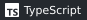
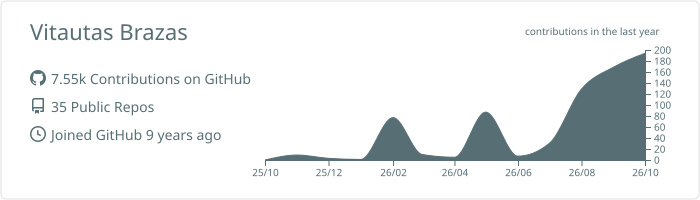

# Vitautas Brazas

**Senior Software Engineer · Payments · AI developer tooling**  
Vancouver, Canada · 7+ years in fintech, travel-tech, EdTech and e-commerce

I'm a backend-focused full-stack engineer at **12Go / Travelier**, working on
payment orchestration and leading our AI-assisted software development initiative.
I build with PHP and Symfony, Go, TypeScript and React.

## Engineering experience

- **Payments at scale.** Contributed to 16 provider integrations in Travelier's
  PayIn orchestrator and designed its fee contract.
- **Financial correctness.** Rewrote refund pricing for 20 currencies with 139
  data-driven test scenarios; added guards against late webhooks reverting paid
  transactions.
- **Teams and delivery.** Built and led a six-person engineering team at
  mysoul.help, shipping the MVP in 12 weeks.
- **Developer tooling.** Created 12Go's AI development initiative: shared
  coding-agent configuration, reusable skills and AI pull-request review.

## Selected projects

- [**cc-millz**](https://github.com/Millon15/cc-millz) · **AI developer tooling**  
  A plugin marketplace for Claude Code and Codex, including paired-agent workflows,
  research tools and integrations with upstream tools.
- [**bbkt**](https://github.com/Millon15/bbkt) · **Go contributions**  
  My fork of [zach-snell/bbkt](https://github.com/zach-snell/bbkt): pull-request
  comment pagination, resolution-state handling and CLI/MCP fixes with regression
  tests.
- [**valentine-2026**](https://github.com/Millon15/valentine-2026) · **React / TypeScript**  
  A configurable quiz app with persistent progress, responsive UI and component
  tests. A small personal project, built to be adapted.

## Core tools

## GitHub activity

<picture>
  <source media="(prefers-color-scheme: dark)" srcset="profile-summary-card-output/github_dark/0-profile-details.svg">
  
</picture>

Most of my professional work lives in private repositories.
